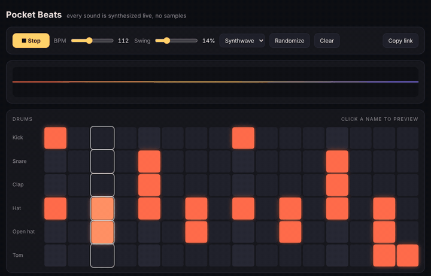

# Pocket Beats

A step sequencer with six drums and a synth, where every sound is generated live in the browser. No samples, no libraries.

**▶ Make a beat: [jessyroest.github.io/pocket-beats](https://jessyroest.github.io/pocket-beats/)**

## Features

- 16 steps, 6 drum voices (kick, snare, clap, closed and open hat, tom)
- A synth on a pentatonic scale, so any pattern sounds musical. Neighbouring steps tie into longer notes.
- Filter cutoff, resonance, waveform, and a tempo-synced delay
- Swing, BPM, presets and a randomizer
- **Beats live in the URL**: hit *Copy link* and send someone your pattern

## How the sounds are made

Everything is built from Web Audio nodes:

- **Kick**: a sine wave whose pitch drops fast, plus a tiny noise click
- **Snare**: band-passed noise plus a short triangle tone
- **Clap**: three quick noise bursts and a tail, like several hands
- **Hats**: six detuned square waves through a high-pass filter
- **Synth**: two slightly detuned oscillators through a resonant low-pass with an envelope

Timing uses a look-ahead scheduler: a timer wakes up every 25 ms and books the next notes on the audio clock, so the beat stays tight even when the page is busy.

No build step: open `index.html` in a browser and press space.
